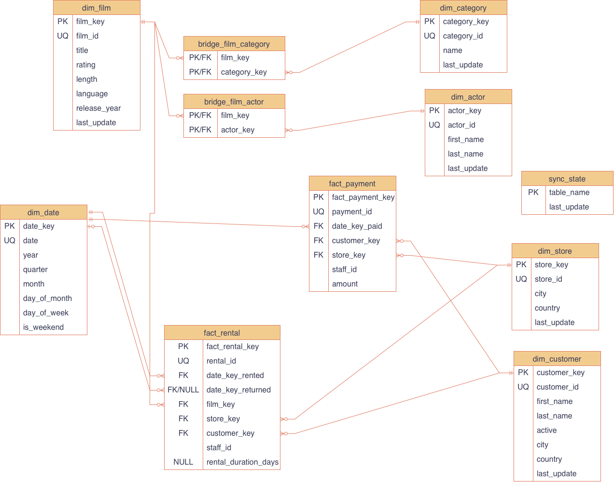

# Assignment 4: ORM Data Sync

## 1. Overview

### Project Objective

This project implements a Python data synchronization pipeline that transfers data from the MySQL Sakila database into a SQLite analytics database using SQLAlchemy ORM.

It supports an initial full load, incremental updates based on timestamps, and validation to ensure consistency between the two databases. All application data reads and writes use the ORM.

### Language, ORM, and Versions

- **Language:** Python 3
- **ORM:** SQLAlchemy 2.x
- **Source database:** MySQL 8.0 (Sakila)
- **Target database:** SQLite
- **MySQL driver:** PyMySQL
- **Testing framework:** pytest

Dependencies and their supported versions are listed in `requirements.txt`.

## 2. Setup

### Dependencies and Installation

From the project directory, create a virtual environment and install dependencies:

```bash
python -m venv .venv
```

Activate the virtual environment:

**macOS/Linux:**
```bash
source .venv/bin/activate
```

**Windows:**
```bash
.venv\Scripts\activate
```

Install dependencies:

```bash
python -m pip install -r requirements.txt
```

### MySQL Sakila Setup

Install MySQL 8.0 and load the official Sakila sample database.

For testing, create a separate database named `sakila_test` containing a copy of the Sakila schema and sample data. Tests should begin with an unmodified copy of this data to avoid affecting the original database.

### Environment Variables

Copy `.env.example` to `.env` and configure:

| Variable | Description |
|---|---|
| `MYSQL_HOST` | MySQL server hostname |
| `MYSQL_PORT` | MySQL port |
| `MYSQL_USER` | MySQL username |
| `MYSQL_PASSWORD` | MySQL password |
| `MYSQL_DATABASE` | Source database (`sakila`) |
| `MYSQL_TEST_DATABASE` | Test database (`sakila_test`) |
| `SQLITE_DATABASE_PATH` | SQLite analytics database path |
| `SQLITE_TEST_DATABASE_PATH` | SQLite test database path |

The `.env` file is excluded from Git to protect credentials.

## 3. Database Schema

### Source and Analytics Models

The source models represent 15 Sakila tables in MySQL.

The SQLite analytics schema contains:

- **Dimensions:** `dim_date`, `dim_film`, `dim_actor`, `dim_category`, `dim_store`, `dim_customer`
- **Bridges:** `bridge_film_actor`, `bridge_film_category`
- **Facts:** `fact_rental`, `fact_payment`
- **Sync metadata:** `sync_state`

Dimension and fact tables use surrogate primary keys and preserve the original Sakila IDs as natural keys. Dimensions use Type 1 updates, overwriting existing attributes when source data changes.

### ER Diagram



## 4. Running the Program

Run all commands from the project root directory.

### init

```bash
python -m src.main init
```

Verifies the MySQL connection and creates the SQLite analytics tables.

### full-load

```bash
python -m src.main full-load
```

Loads all required source records into SQLite. Dimensions are processed before bridges and facts. The operation is transactional and can be rerun without creating duplicates.

### incremental

```bash
python -m src.main incremental
```

Synchronizes new and updated source records using each table's `last_update` timestamp and stored markers in `sync_state`.

The process uses `>=` for change detection and upserts to prevent duplicates. Changes in related tables are also considered.

### validate

```bash
python -m src.main validate
```

Validates consistency between MySQL and SQLite using the 30-day period ending on the latest Sakila payment date.

A custom date range can also be supplied:

```bash
python -m src.main validate --from 2005-07-01 --to 2005-07-31
```

Validation checks row counts, missing records, duplicate natural keys, foreign-key references, and payment totals by store. Payment differences greater than $0.01 are treated as errors.

Full and incremental synchronization also perform validation before committing. Failed validation rolls back the SQLite transaction.

Commands print success or failure messages and return nonzero exit codes on errors.

## 5. Indexes

### Primary Key Indexes

| Table | Column(s) | Purpose |
|---|---|---|
| `dim_date` | `date_key` | Uniquely identifies each calendar date and supports efficient date lookups when joining rental and payment facts. |
| `dim_film` | `film_key` | Uniquely identifies each film dimension row and supports efficient lookups from rental facts and film bridges. |
| `dim_actor` | `actor_key` | Uniquely identifies each actor dimension row and supports efficient actor lookups from the film–actor bridge. |
| `dim_category` | `category_key` | Uniquely identifies each category dimension row and supports efficient category lookups from the film–category bridge. |
| `dim_store` | `store_key` | Uniquely identifies each store dimension row and supports efficient store lookups from rental and payment facts. |
| `dim_customer` | `customer_key` | Uniquely identifies each customer dimension row and supports efficient customer lookups from rental and payment facts. |
| `bridge_film_actor` | `film_key`, `actor_key` | Prevents duplicate film–actor relationships and supports efficient lookups of an exact pair or all actors for a film. |
| `bridge_film_category` | `film_key`, `category_key` | Prevents duplicate film–category relationships and supports efficient lookups of an exact pair or all categories for a film. |
| `fact_rental` | `fact_rental_key` | Uniquely identifies each rental fact row and supports direct lookup of a fact by its surrogate key. |
| `fact_payment` | `fact_payment_key` | Uniquely identifies each payment fact row and supports direct lookup of a fact by its surrogate key. |
| `sync_state` | `table_name` | Ensures each source table has one synchronization marker and supports direct lookup of that table's saved timestamp. |

### Unique Indexes on Natural Keys

| Table | Column | Purpose |
|---|---|---|
| `dim_date` | `date` | Prevents duplicate calendar dates and supports efficient lookup of a date dimension row by its calendar date. |
| `dim_film` | `film_id` | Prevents duplicate source films and supports efficient upsert matching and translation from Sakila film IDs to surrogate keys. |
| `dim_actor` | `actor_id` | Prevents duplicate source actors and supports efficient upsert matching and surrogate-key lookup when building film–actor bridges. |
| `dim_category` | `category_id` | Prevents duplicate source categories and supports efficient upsert matching and surrogate-key lookup when building film–category bridges. |
| `dim_store` | `store_id` | Prevents duplicate source stores and supports efficient upsert matching and surrogate-key lookup when loading facts. |
| `dim_customer` | `customer_id` | Prevents duplicate source customers and supports efficient upsert matching and surrogate-key lookup when loading facts. |
| `fact_rental` | `rental_id` | Prevents duplicate source rentals and supports efficient matching of existing facts during incremental updates and repeated loads. |
| `fact_payment` | `payment_id` | Prevents duplicate source payments and supports efficient matching of existing facts during incremental updates and repeated loads. |

### Bridge Table Indexes

| Table | Column | Purpose |
|---|---|---|
| `bridge_film_actor` | `actor_key` | Supports efficient lookup of all films for an actor; complements the composite primary key, which begins with `film_key`. |
| `bridge_film_category` | `category_key` | Supports efficient lookup of all films in a category; complements the composite primary key, which begins with `film_key`. |

### Fact Table Indexes

| Table | Column | Purpose |
|---|---|---|
| `fact_rental` | `date_key_rented` | Supports efficient filtering by rental date or date range and joins from calendar dates to matching rental facts. |
| `fact_rental` | `date_key_returned` | Supports efficient filtering by return date or date range and retrieval of rentals associated with a return date. |
| `fact_rental` | `film_key` | Supports efficient retrieval of a film's rental facts for film-level analysis and joins from the film dimension. |
| `fact_rental` | `store_key` | Supports efficient retrieval of a store's rental facts for store-level analysis and joins from the store dimension. |
| `fact_rental` | `customer_key` | Supports efficient retrieval of a customer's rental history and joins from the customer dimension. |
| `fact_payment` | `date_key_paid` | Supports efficient filtering by payment date or date range for revenue analysis and joins from the date dimension. |
| `fact_payment` | `customer_key` | Supports efficient retrieval of a customer's payments for spending analysis and joins from the customer dimension. |
| `fact_payment` | `store_key` | Supports efficient retrieval of a store's payments for revenue analysis and joins from the store dimension. |

### Source Model Primary Key Indexes

These declarations in `src/source_models.py` map the primary keys of the existing MySQL Sakila tables. The application does not create the source schema. This list covers keys declared in the source models, not every index that may exist in the installed Sakila database.

| Table | Column(s) | Purpose |
|---|---|---|
| `language` | `language_id` | Uniquely identifies each language and supports efficient language lookups when deriving film dimension attributes. |
| `film` | `film_id` | Uniquely identifies each source film and supports efficient retrieval of selected films during synchronization and lookups from inventory and bridges. |
| `actor` | `actor_id` | Uniquely identifies each source actor and supports efficient actor lookups from film–actor relationships. |
| `category` | `category_id` | Uniquely identifies each source category and supports efficient category lookups from film–category relationships. |
| `film_actor` | `actor_id`, `film_id` | Prevents duplicate actor–film pairs and supports efficient lookup of an exact pair or all film associations for an actor. |
| `film_category` | `film_id`, `category_id` | Prevents duplicate film–category pairs and supports efficient lookup of an exact pair or all category associations for a film. |
| `country` | `country_id` | Uniquely identifies each country and supports efficient country lookups through cities when deriving store and customer attributes. |
| `city` | `city_id` | Uniquely identifies each city and supports efficient city lookups through addresses when deriving store and customer attributes. |
| `address` | `address_id` | Uniquely identifies each address and supports efficient address lookups for stores and customers during synchronization. |
| `store` | `store_id` | Uniquely identifies each source store and supports efficient retrieval of selected stores and lookups from staff and inventory. |
| `staff` | `staff_id` | Uniquely identifies each staff member and supports efficient staff lookups, including store attribution for payments without a rental. |
| `customer` | `customer_id` | Uniquely identifies each source customer and supports efficient retrieval of selected customers and lookups from rentals and payments. |
| `inventory` | `inventory_id` | Uniquely identifies each film copy and supports efficient inventory lookups to resolve a rental's film and store. |
| `rental` | `rental_id` | Uniquely identifies each source rental and supports efficient retrieval of selected rentals and rental lookups from payments. |
| `payment` | `payment_id` | Uniquely identifies each source payment and supports efficient retrieval of selected payments during synchronization. |

### Implementation

All indexes and constraints listed above are declared through SQLAlchemy ORM models using `primary_key=True`, `unique=True`, or `index=True`. The application creates only the SQLite analytics schema; source declarations map existing MySQL tables. No raw SQL is used to create indexes.

SQLite automatically enforces primary keys and unique constraints. Integer primary keys are typically implemented using SQLite's rowid rather than separate index structures. Composite primary keys and unique constraints generally create automatic indexes.

The lookup benefits describe queries these keys and indexes support. Actual index use depends on the query and database query planner; full-table synchronization and validation may still scan entire tables.

## 6. Testing

### Running the Five Automated Tests

The project uses pytest and a separate MySQL test database.

Run all tests:

```bash
python -m pytest tests/ -v
```

The five tests verify:

1. **Initialization:** All required SQLite tables are created.
2. **Full load:** Source data is loaded completely and reruns do not create duplicates.
3. **Incremental inserts:** New source records and relationships appear in SQLite.
4. **Incremental updates:** Existing records, related attributes, and rental returns update correctly.
5. **Validation:** Consistent data passes and deliberately introduced inconsistencies are detected.

The test SQLite database is recreated for testing, while source-data modifications are made against the separate `sakila_test` database.

## 7. Raw SQL Usage

### Usage and Justification

All application data reads, writes, schema creation, and index creation use SQLAlchemy.

The SQLite connection executes `PRAGMA foreign_keys=ON` to enable foreign-key constraint enforcement. This SQLite-specific connection configuration does not have a direct ORM mapping equivalent and does not perform application data reads or writes.

## 8. Citations

### SQLAlchemy Documentation

**Source:** [SQLAlchemy 2.1 Documentation](https://docs.sqlalchemy.org/en/21/)

**Summary:** The documentation explains ORM model definitions, sessions, queries, relationships, transactions, and database connectivity.

**Reflection:** I used SQLAlchemy's declarative mapping and session-based approach to implement database operations in Python without relying on raw SQL. This also provided a consistent interface for working with MySQL and SQLite.

### MySQL Sakila Documentation

**Source:** [MySQL Sakila Sample Database Documentation](https://dev.mysql.com/doc/sakila/en/)

**Summary:** The documentation describes the Sakila database schema, including its tables, primary keys, foreign keys, and relationships.

**Reflection:** I used the documented schema to understand how operational records are connected and identify the relationships needed to construct the analytics tables.

### pytest Documentation

**Source:** [pytest Documentation](https://docs.pytest.org/en/stable/)

**Summary:** The documentation explains automated testing, assertions, fixtures, and test setup.

**Reflection:** I used pytest fixtures and assertions to structure the five required tests and verify the behavior of database initialization, synchronization, and validation.